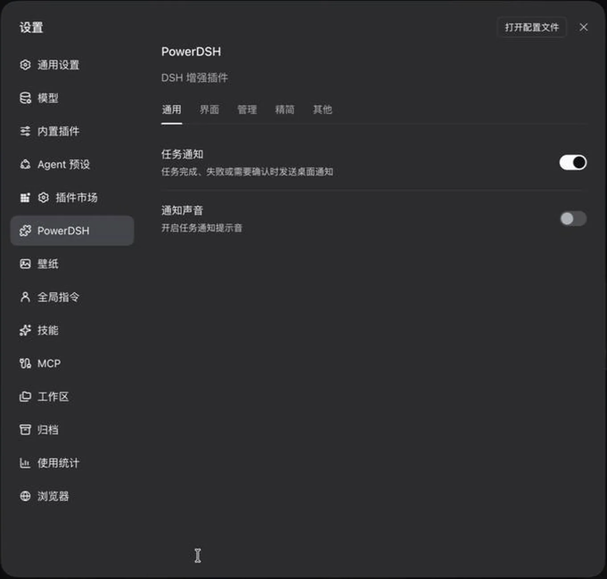

# power-dsh

> **优雅克制，专注实效。让你的 DSH 更顺手、更高效。**\
> *Minimal, elegant, yet deeply powerful. Making your DSH effortless and efficient.*



*0.0.1 · 通用设置（历史截图，展示旧分组；当前分类见下表）*

## 功能清单

<table>
  <thead>
    <tr><th>分类</th><th>功能</th><th>描述</th></tr>
  </thead>
  <tbody>
    <tr>
      <th rowspan="1" scope="rowgroup">通用</th>
      <td>任务通知</td>
      <td>提醒任务完成、出错或需要确认，支持系统提示音选择与试听</td>
    </tr>
  </tbody>
  <tbody>
    <tr>
      <th rowspan="4" scope="rowgroup">界面</th>
      <td>开启自定义壁纸</td>
      <td>界面首行开关；开启后在原生设置左侧显示「壁纸」，位于全局指令上方，在专页选择无壁纸、官网流动、大肥鱼或自定义图片，共用可见度与模糊调节；长按拖动时仅保留当前滑块，松手恢复设置</td>
    </tr>
    <tr>
      <td>快捷推理等级切换</td>
      <td>在模型选择右侧点击切换推理等级，默认仪表盘，可切换信号格</td>
    </tr>
    <tr>
      <td>外观快捷切换</td>
      <td>切换浅色、深色与跟随系统</td>
    </tr>
    <tr>
      <td>显示版本号</td>
      <td>在侧栏显示 DSH 版本，桌面端可点击进入更新流程</td>
    </tr>
  </tbody>
  <tbody>
    <tr>
      <th rowspan="6" scope="rowgroup">管理</th>
      <td>技能管理</td>
      <td>按全局和工作区查看、启停技能，保留共享技能文件</td>
    </tr>
    <tr>
      <td>MCP 管理</td>
      <td>查看全局服务器、工具和运行状态，启停可管理项，并在只读详情弹窗中查看调用方式、运行状态、配置与工具名（环境变量与请求头只显示键名）</td>
    </tr>
    <tr>
      <td>全局指令</td>
      <td>在设置中编辑全局指令</td>
    </tr>
    <tr>
      <td>工作区管理</td>
      <td>按最近活动或侧栏顺序查看工作区目录、会话数与最近活动，搜索后经二次确认移除登记，会话与磁盘文件保留</td>
    </tr>
    <tr>
      <td>归档</td>
      <td>按工作区分组查看和恢复归档会话，支持搜索、排序、工作区筛选及悬浮查看工作区路径、永久删除和按闲置天数自动归档</td>
    </tr>
    <tr>
      <td>使用统计</td>
      <td>按时间范围查看总 Token 与输入输出、缓存与命中率、主会话及子 Agent 用量与累计运行时长，以及 53 周活动热力图、每日趋势与模型占比</td>
    </tr>
  </tbody>
  <tbody>
    <tr>
      <th rowspan="6" scope="rowgroup">精简</th>
      <td>停用官方登录与模型接入</td>
      <td>停用官方登录、账号界面及内置模型接入</td>
    </tr>
    <tr>
      <td>停用官方搜索</td>
      <td>关闭内置 WebSearch，保留 WebFetch。</td>
    </tr>
    <tr>
      <td>停用官方反馈与遥测</td>
      <td>停用官方反馈与遥测</td>
    </tr>
    <tr>
      <td>停用 Todo 工具</td>
      <td>新对话中不再生成待办列表</td>
    </tr>
    <tr>
      <td>停用 Plan 模式</td>
      <td>停用新对话的内置计划模式，保留历史计划</td>
    </tr>
    <tr>
      <td>停用 Goal 模式</td>
      <td>停用新对话的内置目标模式，保留已有目标</td>
    </tr>
  </tbody>
  <tbody>
    <tr>
      <th rowspan="3" scope="rowgroup">其他</th>
      <td>界面刷新</td>
      <td>重新加载当前界面</td>
    </tr>
    <tr>
      <td>重启应用</td>
      <td>重新启动应用，仅在 macOS 打包桌面端显示设置项</td>
    </tr>
    <tr>
      <td>屏蔽双击重命名</td>
      <td>屏蔽侧栏会话标题的双击重命名操作</td>
    </tr>
  </tbody>
</table>

设置按使用频率和功能关联性排序，每项功能均可独立开启。通知声音紧随任务通知，推理按钮样式紧随快捷推理等级切换。表格列出全部功能；「其他」分类收纳界面刷新、重启应用与屏蔽双击重命名，其中 macOS 打包桌面端显示重启设置行，Windows 和 Linux 桌面端隐藏该设置项及菜单入口，保留已有偏好。刷新与重启入口收在侧栏顶部的横向三点「更多操作」菜单中，重启菜单项还需 Host 能力确认。

## 使用

PowerDSH 是独立社区维护的 DSH 插件，以下为桌面版安装说明。

### 桌面版安装

1. 打开 DSH 的 **插件** 页，从 **添加插件** 中选择第三方插件安装入口；旧版宿主可从 **设置 → 插件** 进入。
2. 输入以下 GitHub 安装来源并确认：

   ```text
   github:mewcoder/power-dsh
   ```

3. 等待安装完成并启用 PowerDSH；如果宿主提示需要刷新或重启，按提示操作。
4. 进入 **设置 → PowerDSH**，按需开启各项功能。

安装器会下载仓库中预先构建的 Host／Client 产物及运行依赖，**无需手动编译或编辑 profile 配置**。安装需要能访问 GitHub 和依赖注册表，获取的是远端已推送的代码。

桌面端安装写入 `desktop` 配置档；`dsh web` 使用独立的 `web` 配置档，需另行安装，两者互不影响。

### 命令行安装（可选）

已安装 DSH CLI 时，桌面端对应命令为：

```sh
dsh plugin --profile desktop add github:mewcoder/power-dsh
```

桌面应用会自行管理 `desktop` 配置档，运行时从命令行改动可能与 App 状态冲突，**优先使用上面的插件管理器**。需要装到 `dsh web` 时，把 `desktop` 换成 `web`。配置档说明见[安装说明](docs/development.md#安装与使用)。

正式版本和预构建安装包通过 [GitHub Releases](https://github.com/mewcoder/power-dsh/releases)分发，附件名固定为 `power-dsh.tgz`；本项目不通过 npm 分发。市场[收录申请](https://github.com/awesome-dsh-plugin/awesome-dsh-plugin/pull/14457)已提交，正式收录后补充市场安装入口。

### 宿主要求

DSH 最低已测基线为 **`0.2.0-rc.1`**，安装范围为 `>=0.2.0-rc.1 <0.3.0-0`。已有历史版本兼容检查、macOS 桌面安装与运行验证，以及 Windows 使用反馈；各版本、平台与功能的已测范围和限制见[兼容说明](docs/compatibility.md)。本地开发安装与依赖说明见[安装说明](docs/development.md#安装与使用)。

## 更新记录

具体功能和变化随版本记录，详见[更新日志](CHANGELOG.md)与[版本发布记录](https://github.com/mewcoder/power-dsh/releases)。宿主版本要求见[兼容说明](docs/compatibility.md)。

## 文档与贡献

[文档索引](docs/README.md)汇总产品、界面、架构与各项功能说明。参与开发先读[开发指南](docs/development.md)，按流程检查工作区、实现与验证；AI 协作者从[协作入口](AGENTS.md)开始。版本发布与市场收录见[发布与升级](docs/releasing.md)。

## 链接

[GitHub](https://github.com/mewcoder/power-dsh) · [问题反馈](https://github.com/mewcoder/power-dsh/issues) · [第三方资源声明](docs/third-party-notices.md)
