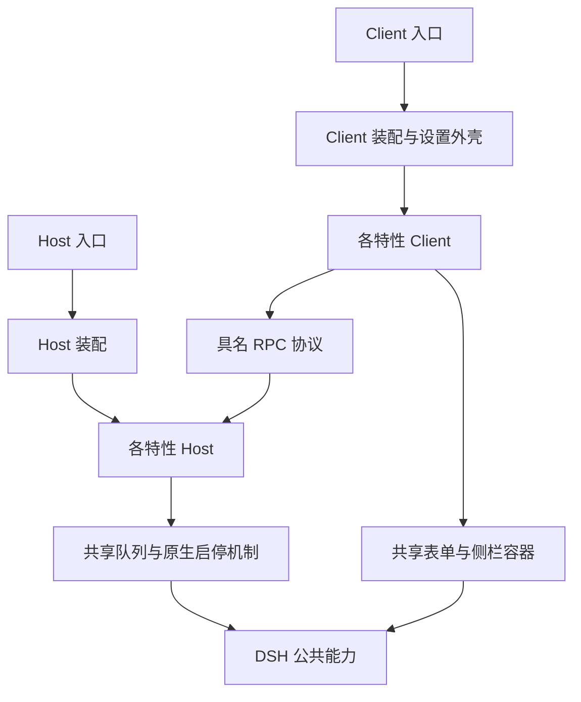

# 按特性组织的架构方案

状态：设计提案。本文描述下一步重构的目标，当前运行代码仍采用[架构规范](architecture.md)记录的结构；本方案没有引入构建工具、修改安装方式或迁移现有实现。[功能 Spec 规范](feature-spec.md)作为文档维护规则先行生效。

## 目标与当前问题

保持一个 PowerDSH 安装项，在包内按用户能力划分特性模块。一个特性拥有自己的配置定义、Host 逻辑、Client 展示、RPC 协议、文案、Spec 和测试；装配层只负责组合与接入宿主。

当前 [Client](../src/client.js)集中管理所有页面、样式、文案、订阅和交互；[Host 入口](../src/index.js)同时维护全部配置、实例创建、RPC 转发和设置工具。这些中央维护点使新增或删除特性必须检查其他功能的实现，仅移动到 `src/` 没有解决这一问题。[共享策略](../src/plugin-policy.js)的偏好保存已改为保留其他功能字段，模块化后继续保持这一约束。

## 目标目录

以下是建议结构，目录与文件按实际职责创建；仅有 Client 行为的特性不创建空 Host 或 RPC 文件。

```text
src/
  index.js                      # 保持对外 Host 入口，只转交装配
  client.js                     # 保持对外 Client 入口
  app/
    host.js                     # Config 合并、Host 装配、稳定 RPC 门面
    client.js                   # 设置页、侧栏容器、Client 装配
    host-features.js             # 显式选择参与装配的 Host 特性
    client-features.js           # 显式选择参与装配的 Client 特性
  shared/
    host/
      operation-queue.js
      plugin-policy.js          # 原生插件启停与写后读回的共享机制
    client/
      settings-shell.js         # 分类、设置行、错误与忙碌反馈
      sidebar-shell.js          # Mod 自有容器与共享操作菜单
    rpc/
      codecs.js                 # 确有复用的校验，不存业务状态
  features/
    notifications/
      spec.md                   # 此功能唯一主规格
      definition.js             # id、分类、顺序等环境无关元数据
      config.js                 # 本功能的 Host 配置 schema
      host.js
      client.js
      rpc.js                    # Host/Client 共用的协议与校验
      locales.js
      system-sounds.js          # 通知内部子模块
      tests/
        host.test.mjs
        client.test.mjs
    double-click-rename/
      spec.md
      definition.js
      config.js
      client.js
      locales.js
      tests/
        client.test.mjs
    ...
tests/
  integration/                  # 完整装配、公开导出与特性组合
```

单文件够用的功能不强制细分页面、controller、service 等层。通知声音是任务通知的子能力，MCP 提供方目录属于 MCP 管理内部实现，不为了每个源文件再定义一种用户特性。「通用／增强／精简」只用于设置页分类，不作为模块依赖层级。

## 装配与依赖

- 特性只能依赖 DSH 已核对的公共能力、本特性内部文件和 `shared/`；不直接导入其他特性的实现或状态。
- Host 与 Client 使用分开的显式装配清单。移除一项装配登记即可从相应组合中排除该模块；保留检查，避免遗漏必需的另一端。首次迁移保留全部现有特性，暂不提供新的用户配置或构建裁剪产品。
- `definition.js` 只含环境无关的数据；Host schema 和 Node 依赖不进入 Client 导入链，Client 不携带 Host 文件读写、进程管理或凭据访问代码。
- 装配层合并配置、双语 key、设置贡献与 RPC 描述时检查重复和缺项。配置键、设置命名空间、包导出与已有 RPC 方法保持稳定；目录名不是配置迁移机制。
- 每项设置声明它拥有的配置键、默认值、展示信息及保存操作。简单偏好与必须执行 Host 操作的精简开关分别绑定保存路径，设置页不再维护逐功能的条件分支。
- 配置更新只修改请求所属字段，保留其他特性的偏好；共享策略不维护「所有功能字段」白名单。
- 设置工具沿用公开的具名参数与操作，RPC 沿用严格校验及 owner 校验。装配可以聚合声明，不能以通用字符串分发器扩大远程可调用能力。



## 策略模式的使用范围

账号精简和遥测精简已经共享 [PluginPolicy](../src/plugin-policy.js)，适合继续把目标匹配、操作顺序及偏好键作为策略差异，复用执行、原生结果检查和读回。是否使用继承或对象注入取决于是否减少重复，不为模式名称强行改写。

搜索与 Todo 还涉及模式组合、现有 Agent 限制及生命周期，保留各自策略实现；只有相同的真实步骤才提取共享函数。通知、个性化编辑、技能目录、MCP 管理和应用重启有不同的操作语义，不要求实现同一个 `setEnabled()` 或继承统一业务基类。

「可插拔」在这里指特性拥有清晰的依赖与释放边界，并可由装配选择。它不自动意味着每项特性都发布一个 npm 包，或另建动态插件市场、扫描器、全局事件总线和服务定位器。现阶段继续交付一个 Cordis bundle，生命周期复用宿主 context。

## 生命周期与开关

区分模块是否参与装配、功能主开关，以及功能内部条目的状态。关闭设置入口不能自动清除技能限制；关闭精简开关必须按原规则启用目标；卸载整个模块也不能被解释成恢复所有持久化目标。每项差异写在该功能 Spec 中。

每个特性在自己的子 context 中持有监听、计时器、投影和资源，随所属 context 释放。可选服务由该特性局部接入，缺少服务时按其 Spec 显示不可用或隐藏适当入口，不让辅助能力阻断全部设置页。配置写入继续经过同一 Host 队列与权限检查，不给每个功能另建可相互竞态的写入通道；音效等已有独立并发语义保持不变。

刷新和重启共享的菜单由 Client 装配外壳拥有，特性只贡献自己的动作。删除刷新项不应删除重启项；没有可用动作时不显示空菜单。其他共享布局也明确一个所有者，不能让多个模块互相查询 DOM 或争用宿主 slot。

## Spec 对应与现有功能迁移

每个用户功能对应一份主 Spec，要求见[功能 Spec 规范](feature-spec.md)。当前继续使用现有功能文档；迁移某个模块时把该文档迁入模块的 `spec.md`，同步索引与引用，旧位置如需保留只作跳转说明，不保留第二份行为正文。

| 建议特性 id | 当前主 Spec | 归属说明 |
| --- | --- | --- |
| `version-display` | [显示版本号](version-display.md) | 显示宿主版本与原生更新入口 |
| `appearance-shortcut` | [外观快捷切换](appearance-shortcut.md) | 主题切换与入口定位 |
| `refresh-button` | [刷新界面](refresh-button.md) | 操作菜单中的刷新项 |
| `restart-button` | [重启应用](restart-button.md) | 重启确认、Host 操作与菜单项 |
| `notifications` | [任务通知](notifications.md) | 包含系统声音子能力 |
| `personalization` | [个性化](personalization.md) | 全局指令文件与编辑页 |
| `skills` | [技能管理](skills.md) | 包含来源解析与调用策略 |
| `mcp` | [MCP 管理](mcp.md) | 包含提供方目录、启停与工具展示 |
| `account-blocking` | [精简官方登录与模型接入](account-blocking.md) | 使用共享原生启停机制 |
| `search-blocking` | [精简官方搜索](search-blocking.md) | 保留独立搜索策略 |
| `telemetry-blocking` | [反馈与遥测精简](telemetry-blocking.md) | 使用共享机制并保留目标顺序 |
| `todo-blocking` | [精简Todo工具](todo-blocking.md) | 保留模式与 Agent 限制策略 |
| `double-click-rename` | [屏蔽双击重命名](double-click-rename.md) | 局部 Client 事件监听 |

## Client 拆分与分发约束

当前 [Client](../src/client.js)通过 `window.__ModuleLoader__.load()` 提交单个 factory，使用宿主提供的 React 和公共组件；[包清单](../package.json)目前只有一个 `./client` 入口且没有构建步骤。不能直接把普通 ESM 导入拆到多个文件，就宣称符合现有宿主加载协议。

建议在迁移 Client 前，先核对目标发行版的模块加载与产物格式。若需要打包，采用成熟工具的最小 Client 构建，将特性源码合并为宿主可加载的入口，并保持 React 和宿主公共模块的共享身份；Host 尽量继续直接使用 ESM。不要为了维持表面上的「无构建」而自制模块加载器、字符串拼接框架或跨功能全局对象。

引入构建工具属于单独的实施选择，本文不添加依赖。若采用构建，必须同步[GitHub 源码安装](development.md#从-github-安装)与[分发流程](releasing.md)：Git 安装须有可执行且按宿主要求授权的构建途径，或改用已包含产物的来源。不得继续承诺用户从干净源码安装无需构建，也不因本机已有输出就认定 GitHub 安装可用。

## 迁移顺序与验收

1. 固定现有配置键、RPC、文案和行为，以现有行为测试为迁移前基线；先补齐每项主 Spec。
2. 先选「屏蔽双击重命名」验证一个小型 Client 特性的完整归属，再用「账号精简」验证 Host 策略归属。Client 产物方案未确定时只先迁移 Host，不制造暂时无法加载的 Client 入口。
3. 提取实际共享的设置外壳、侧栏菜单和队列；逐项迁移特性。每迁移一项，同时迁移文案、样式、协议和相关测试，避免目录下有新文件而业务继续留在大文件里。
4. 在模块归属稳定后聚合 Config、设置贡献与严格 RPC 描述。删除旧的重复定义，再清理入口文件；配置保存不引入跨功能字段白名单。
5. 更新检查脚本、打包清单和兼容检查的复制规则，使其覆盖嵌套模块与 Spec；检验未登记的 Spec、重复 id、非法跨特性导入和 Host 代码进入 Client 产物。
6. 保留单特性行为测试，并用完整装配测试核对默认全关闭、各项独立开关、共享菜单组合、局部服务缺席、卸载释放、偏好保留及 Host/Client 协议匹配。装配排除测试使用内存配置，不修改真实 profile。
7. 最终核对干净源码或实际 tarball 的安装、加载与真实页面，按影响重跑旧版 SDK 回归。新增构建与模块化后的验证结论单独记录，不沿用原安装证据。

阶段验收的标准是：新增功能主要修改自己的模块、必要的显式装配登记和索引；其他特性无需了解它的实现。仅减少入口行数或创建更多文件夹不算完成模块化。
